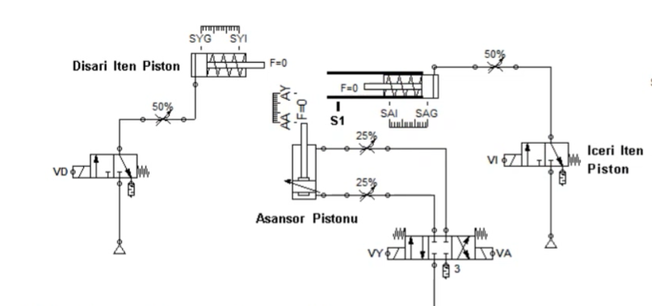
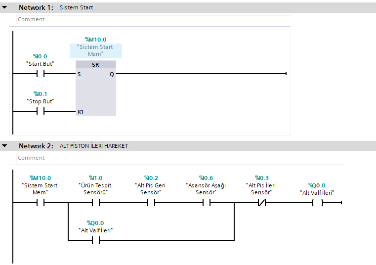
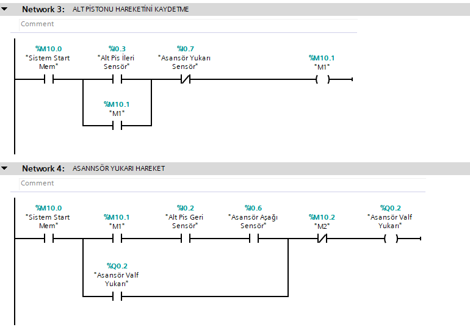
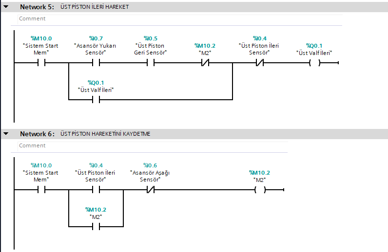
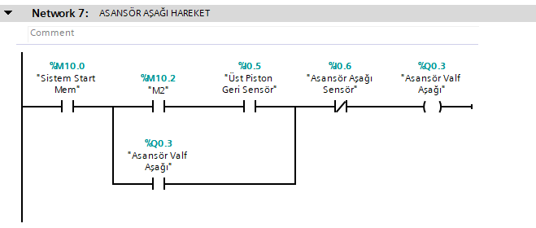

# 🏭 TIA Portal: Pnömatik Asansörlü ve Pistonlu Parça Transfer İstasyonu (State Machine & Ladder Logic)

Bu proje, **Siemens TIA Portal** ve **S7-PLCSim** kullanılarak geliştirilmiş; pnömatik silindirler, dikey asansör mekanizması ve ardışık adım hafızaları (`M1`, `M2`) ile kurgulanmış profesyonel bir **parça transfer ve taşıma otomasyonu** sistemidir.

---

## ⚙️ Pnömatik Sistem Mantığı ve Çalışma Senaryosu
1. **Sistem Başlatılması:** `Start` butonuna basıldığında sistem Set/Reset (SR) bloğu üzerinden aktifleşir.
2. **Besleme (Alt Piston İleri):** Ürün tespit sensörü parça algıladığında ve mekanik emniyet koşulları sağlandığında alt piston ileri hareket ederek ürünü iter.
3. **Adım Kaydı (`M1`):** Alt piston görevi tamamlayıp ileri limitine ulaştığında `M1` hafıza biti set edilerek bir sonraki aşamaya geçilir.
4. **Dikey Taşıma (Asansör Yukarı):** `M1` onayıyla birlikte asansör mekanizması ürünü yukarı taşır.
5. **Transfer (Üst Piston İleri):** Asansör üst konuma ulaştığında üst piston devreye girerek parçayı transfer eder.
6. **İkinci Adım Kaydı (`M2`) ve Evine Dönüş:** Üst piston hareketini tamamlayıp `M2` hafızasını aktif ettiğinde, asansör aşağı inerek sistemi başlangıç pozisyonuna döndürür.

---

## 🖥️ Network Adımları ve Görsel Simülasyon

### Pnömatik Sistem Şeması ve İstasyon Mimarisi
* **Sistem Tasarımı:**
  
> **Açıklama:** Projede kullanılan asansör pistonu, dışarı/içeri iten pistonlar, 5/2 yön kontrol valfleri (VD, VI, VY, VA) ve optik/manyetik sensör yerleşimleri.

---

### Network 1 & 2: Start/Stop ve Alt Piston İleri Hareketi
* **TIA Portal Kodu:**
  
> **Açıklama:** `%I0.0` start sinyaliyle sistem açılır. Ürün tespit sensörü (`%I1.0`) parça gördüğünde, alt piston geri ve asansör aşağıda koşulları sağlanarak alt piston valfi (`%Q0.0`) tetiklenir.

---

### Network 3 & 4: Adım Hafızası (`M1`) ve Asansör Yukarı Hareketi
* **TIA Portal Kodu:**
  
> **Açıklama:** Alt piston ileri gidip (`%I0.3`) sinyal verdiğinde `M1` hafızası (`%M10.1`) kaydedilir. Bu onayla birlikte asansör yukarı valfi (`%Q0.2`) aktifleşerek dikey taşıma başlatılır.

---

### Network 5 & 6: Üst Piston İleri Hareketi ve Adım Hafızası (`M2`)
* **TIA Portal Kodu:**
  
> **Açıklama:** Asansör yukarıda limitine ulaştığında üst piston ileri valfi (`%Q0.1`) tetiklenir. Piston ileri gittiğinde (`%I0.4`) ikinci adım hafızası olan `M2` (`%M10.2`) set edilir.

---

### Network 7: Asansör Aşağı Hareketi (Başlangıç Konumu)
* **TIA Portal Kodu:**
  
> **Açıklama:** `M2` hafızası aktifleştiğinde ve üst piston geri döndüğünde, asansör aşağı valfi (`%Q0.3`) tetiklenerek sistem güvenli bir şekilde başlangıç evine döndürülür.

---

## 🛠️ Kullanılan Teknolojiler ve Araçlar
* **PLC Programlama:** Siemens TIA Portal (Ladder Logic - LAD, State Machine & Adım Hafızaları)
* **Simülasyon / Tasarım Ortamı:** Siemens S7-PLCSim & Pnömatik Devre Şemaları
* **Sürüm Kontrol:** Git & GitHub
